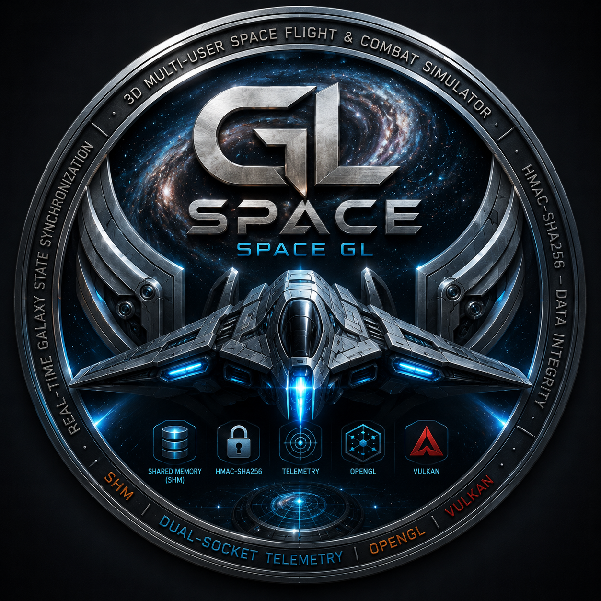
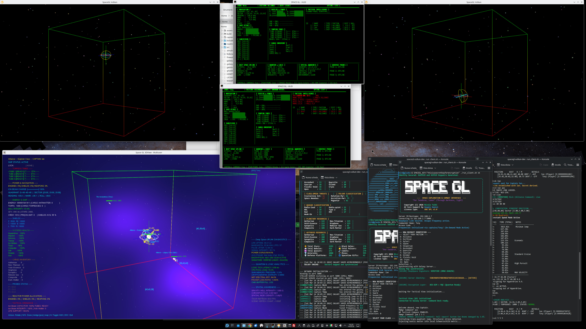
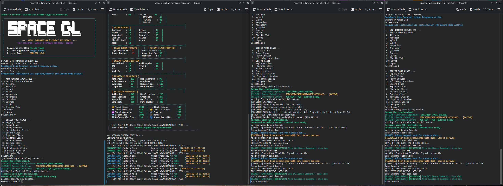
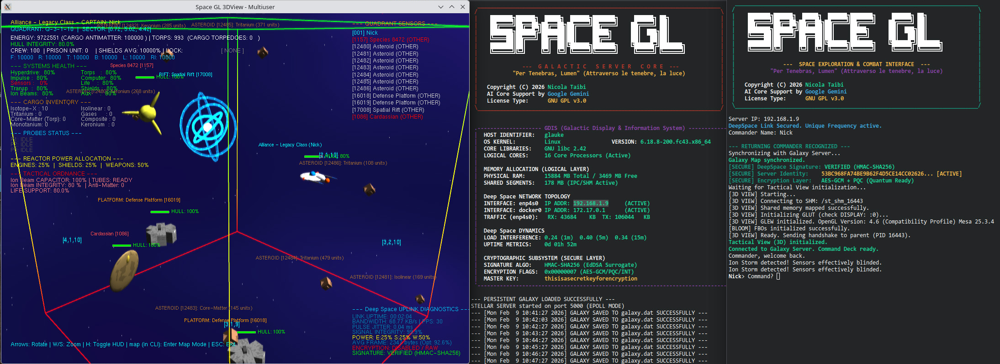
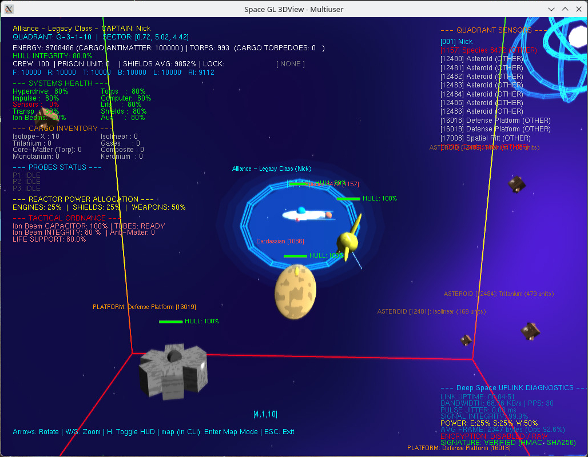
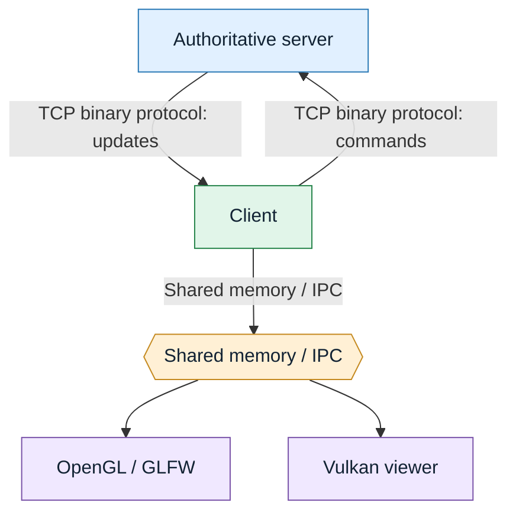

<div align="center">

# Space GL

<table align="center">
  <tr>
    <td align="center">
      <div align="center">
        
        
      </div>
    </td>
  </tr>
</table>

### Persistent Galaxy Tactical Navigation & Combat Simulator

[](https://github.com/nicolataibi/spacegl)
[](https://www.gnu.org/licenses/gpl-3.0.html)
[](https://en.wikipedia.org/wiki/C_(programming_language))
[](https://www.khronos.org/)
[](https://www.kernel.org/)

**A multi-user, client-server 3D space exploration and combat simulator, combining a persistent galaxy, tactical command gameplay, real-time state synchronization, and OpenGL/Vulkan visualization.**

[Features](#features) · [Architecture](#architecture) · [Build](#build) · [Quick start](#quick-start) · [GPU-driven rendering](#gpu-driven-rendering) · [Tests](#testing) · [Documentation](#documentation) · [License](#license)

</div>

---

## Overview

SpaceGL is a C-based, multi-user space flight and combat simulator inspired by the command-driven space games of the 1970s. It combines a persistent simulated universe and authoritative server with a command-line client and optional 3D tactical viewers.

The project separates simulation and network synchronization from rendering. The server owns the authoritative game state; clients exchange updates over a binary TCP protocol; local visualization processes consume synchronized state through shared memory. The graphics front ends include an OpenGL/GLFW path and a Vulkan renderer.

The current project documentation describes two Vulkan rendering modes: the established CPU-driven renderer and an optional GPU-driven rendering (GDD) path. GDD is enabled at startup with `SPACEGL_GPD=1`; the CPU-driven path remains the default and is used as a graceful fallback when the required Vulkan capabilities are unavailable.

> **Project status:** the supplied documentation describes version 3.3, *The Living Catalog* (release 2026.10.24), which extends the numbered object catalog to IDs 0–177 (natural moons, evolved stars, protostellar objects, exotic compact objects) on top of the GPU-driven rendering path introduced in 3.2. Refer to the repository changelog and release assets for the exact state of a particular checkout.

## Features

- **Persistent galaxy simulation** with exploration, navigation, tactical combat, resources, starbases, anomalies, derelicts, and NPC factions.
- **Authoritative client-server model** that keeps game logic and world state on the server.
- **Efficient binary networking** with differential updates, interest management, and quadrant-based static-data caching.
- **Local IPC for visualization** using shared memory and synchronized state exchange between the client and 3D viewers.
- **Multiple visualization front ends**, including OpenGL/GLFW and Vulkan.
- **Optional GPU-driven Vulkan rendering** using compute shaders, GPU culling, generated geometry, and indirect drawing.
- **Living object catalog (3.3)** spanning IDs 0–177, defined once in `include/object_types.h` and shared by the server, HUD, OpenGL viewer, and both Vulkan paths: 23 classes of natural moons on real, deterministic planetary orbits (at most 4 per planet), 17 evolved-star classes, 16 protostellar and young-stellar-object classes, and 32 exotic compact objects.
- **Tactical telemetry** for monitoring network and simulation behavior.
- **Secure session setup** using a shared master secret for the handshake, per-session keying as documented by the project, HMAC-SHA256 integrity mechanisms, and selectable radio encryption modes.
- **Developer-focused validation** with CMake, CTest, contract tests, sanitizer-enabled Debug tests, and Vulkan validation-layer support.

## Screenshots

The repository's `readme_assets/` directory contains screenshots and artwork for the OpenGL and Vulkan viewers. These images are displayed when the corresponding files are present in the checkout.

### OpenGL / GLFW

<div align="center">
  
  
</div>
<div align="center">
  
  
</div>

### Vulkan

<div align="center">
  
  
</div>
<div align="center">
  
  
</div>

*If an image does not render, verify that its path and filename match the repository exactly; some asset names contain spaces.*

## Architecture

At a high level, SpaceGL uses three cooperating components:

1. **Server** — owns the authoritative galaxy and simulation state, processes commands, updates entities, and sends network updates.
2. **Client** — connects to the server, handles command interaction and receives state updates.
3. **Viewer / visualization tools** — render the synchronized state and expose tactical or diagnostic information.

### State and network flow



The server uses spatial indexing and interest management to limit updates to relevant entities. Differential packets carry changed data blocks rather than repeatedly transmitting the complete state. The client reconstructs the current state and publishes it to local visualization processes through shared IPC.

### Main components

The source tree documents eight product executables:

| Target | Purpose |
|---|---|
| `spacegl_server` | Authoritative game server |
| `spacegl_client` | Command/client process |
| `spacegl_3dview` | 3D visualization front end |
| `spacegl_viewer` | Viewer utility |
| `spacegl_hud` | Tactical HUD |
| `spacegl_vulkan` | Vulkan tactical renderer |
| `spacegl_diag` | Diagnostics |
| `spacegl_telemetry` | Telemetry client |

The CMake build also defines `spacegl_shaders`, which compiles the project's GLSL shader sources to SPIR-V with `glslc`.

> The executable names produced by CMake use underscores. The hyphenated commands in the usage guide (`spacegl-server`, `spacegl-client`, `spacegl-diag`) are launcher scripts shipped in the repository root. Each looks for the matching underscore binary in `./build/`, then in the current directory, then in `PATH`, so build the project first.

## GPU-driven rendering

The Vulkan viewer supports two rendering architectures, selected at process startup with `SPACEGL_GPD`.

| Setting | Renderer | Behavior |
|---|---|---|
| Unset or `SPACEGL_GPD=0` | CPU-driven (legacy) | Default path; CPU records per-object draw work |
| `SPACEGL_GPD=1` | GPU-driven (GDD) | CPU uploads compact instance lists; GPU performs culling, geometry expansion, and indirect-draw setup |

The GDD path uses compute shaders for culling, geometry expansion, and final draw-command generation. It then renders opaque and additive passes using indirect drawing. The CPU/GPU data contract is shared between `include/spacegl_gdd.h` and `assets/shaders/gdd_common.glsl`, with compile-time layout assertions and contract tests.

### Requirements and fallback

- GPU-driven rendering requires a Vulkan 1.3-or-newer-capable driver and a queue family that supports both graphics and compute.
- The build requires `glslc` to compile the shader sources.
- If GDD initialization is not supported or fails, the documented behavior is to print a diagnostic and fall back to the CPU-driven renderer.
- Debug builds request `VK_LAYER_KHRONOS_validation` by default. `SPACEGL_VALIDATION=0` disables it; `SPACEGL_VALIDATION=1` requests it even in Release builds.

Examples:

```bash
# Default CPU-driven renderer
./build/spacegl_vulkan

# Explicitly select the CPU-driven renderer
SPACEGL_GPD=0 ./build/spacegl_vulkan

# Request GPU-driven rendering
SPACEGL_GPD=1 ./build/spacegl_vulkan

# Request GPU-driven rendering and Vulkan validation
SPACEGL_GPD=1 SPACEGL_VALIDATION=1 ./build/spacegl_vulkan
```

## Build

### Supported environment

The development guide identifies Fedora Linux as the reference build environment. The project uses C, CMake, pkg-config, OpenGL-related libraries, GLFW, OpenSSL, OpenMP, Vulkan headers/loader, and `glslc`.

The documented reference toolchain is GCC with C23 support. CMake 3.10 or newer is specified for the main build and CMake 3.16 or newer for the standalone tests project.

### Dependencies on Fedora

Install the documented development packages:

```bash
sudo dnf install gcc-c++ cmake pkgconf-pkg-config \
  mesa-libGL-devel libGLU-devel glfw-devel \
  ncurses-devel openssl-devel openmp-devel \
  vulkan-loader-devel vulkan-headers glslc
```

A working graphics driver and Vulkan implementation are also needed to run the graphical applications. GPU-dependent tests may be skipped when no usable Vulkan ICD or compiled SPIR-V is available.

### Configure and compile

From the repository root:

```bash
cmake -B build
cmake --build build -j"$(nproc)"
```

The default build type is `Release`. To choose another build type:

```bash
# Debug build
cmake -B build -DCMAKE_BUILD_TYPE=Debug
cmake --build build -j"$(nproc)"

# RelWithDebInfo, suitable for profiling
cmake -B build -DCMAKE_BUILD_TYPE=RelWithDebInfo
cmake --build build -j"$(nproc)"

# MinSizeRel
cmake -B build -DCMAKE_BUILD_TYPE=MinSizeRel
cmake --build build -j"$(nproc)"
```

### Build helper

The included `build.sh` wraps configuration, compilation, and test execution:

```bash
./build.sh       # Release build + tests
./build.sh -d    # Debug build + tests (ASan/UBSan in tests)
./build.sh -r    # RelWithDebInfo + tests
./build.sh -s    # MinSizeRel + tests
./build.sh -c    # Clean build directory, rebuild, and test
./build.sh -t    # Run tests only; requires an existing configured build
./build.sh -n    # Build only, skip the test suite (options can be combined, e.g. -cn)
./build.sh -h    # Show help
```

The clean option removes the local `build/` directory before rebuilding. Do not use it if that directory contains files you need to preserve.

### Vulkan SDK selection

The build system resolves Vulkan dependencies through the shared `cmake/SpaceGLVulkanSDK.cmake` module. As documented in `DEVELOPMENT.md`, it checks:

1. A usable `VULKAN_SDK` environment variable.
2. The project's pinned default SDK (`DEFAULT_VULKAN_SDK`, a maintainer-local path), unless disabled. If that path does not exist on your machine, CMake skips it silently and continues to the system Vulkan.
3. The system Vulkan package and loader.

To opt out of the pinned SDK and use system discovery, configure with:

```bash
cmake -B build -DUSE_DEFAULT_VULKAN_SDK=OFF
```

If `VULKAN_SDK` is set to a stale or unusable path, CMake warns and continues through the resolution chain. `glslc` is a required build dependency; the project does not document a `glslangValidator` fallback.

## Quick start

The repository's `HOWTO.txt` documents starting the server and connecting a client using the same `SPACEGL_KEY`. Start the server and each client in separate terminals. Run the commands from the repository root after building (see above).

### 1. Generate a shared secret

Generate a fresh random key and keep it private:

```bash
export SPACEGL_KEY="$(openssl rand -hex 32)"
```

Run this once for the server's key value. Provide the same value to each authorized client through a secure channel. Do not commit the key, paste it into public issue reports, or reuse a real secret from another environment.

### 2. Start the server

In terminal 1, from the directory containing the runtime launcher:

```bash
./spacegl-server
```

Keep this terminal open while the server is running.

### 3. Start a client

In terminal 2, set `SPACEGL_KEY` to the **same value generated for the server**, then select the renderer:

```bash
# OpenGL / GLFW client
export SPACEGL_KEY="<same-secret-value>"
./spacegl-client gl
```

Or:

```bash
# Vulkan client
export SPACEGL_KEY="<same-secret-value>"
./spacegl-client vk
```

The handshake is expected to fail if the server and client use different key values. Do not place a real key directly in shell history or in source control. For persistent or multi-user deployments, prefer `SPACEGL_KEY_FILE` instead: point it to a file containing the 64 hexadecimal characters of the key. The file must have mode `0600`; the server and client refuse to start if it is group- or world-accessible. Key lookup order is `SPACEGL_KEY_FILE`, then `SPACEGL_KEY`, then an auto-generated `$HOME/.spacegl/key`. See `SECURITY.md`.

> These commands follow `HOWTO.txt`. The launcher scripts are in the repository root; if you installed from a package, use the entry points that package provides.

## Testing

The development guide documents a CTest suite covering CPU/GPU data contracts, shader/mesh parity, navigation math, spatial indexing, packet lengths, cryptographic table behavior, bounds checks, packet fuzzing, rendering parity, and GDD benchmarks.

### Integrated test suite

After configuring and building the main tree:

```bash
ctest --test-dir build --output-on-failure
```

Or run the full build-and-test loop:

```bash
./build.sh
```

### Standalone tests

The `tests/` directory can also be configured as a separate CMake project:

```bash
cmake -B build-tests tests -DCMAKE_BUILD_TYPE=Debug
cmake --build build-tests -j"$(nproc)"
ctest --test-dir build-tests --output-on-failure
```

The GPU mesh test may return the configured skip code when a Vulkan ICD or required SPIR-V is unavailable. This is distinct from a test failure.

For test design, sanitizer use, the list of test contracts, and Vulkan validation details, see [DEVELOPMENT.md](DEVELOPMENT.md).

## Configuration and gameplay

Gameplay and balancing parameters are documented as centralized in `include/game_config.h`. Rebuild after changing compile-time configuration values.

Documented configuration areas include:

- Server tick rate and maximum player count.
- Ship movement and interpolation.
- Energy and torpedo capacities.
- Weapon damage and system integrity.
- Mining, harvesting, docking, and boarding interaction distances.
- NPC and environmental-event behavior.
- Action energy costs (`COST_*`, including cloak, hyperdrive, wormhole, boarding, probe launch, and encryption shifts).
- Galaxy population ranges for every object type (`GALAXY_OBJECT_MIN_*` / `GALAXY_OBJECT_MAX_*`) and for objects created at runtime (`GALAXY_CREATE_OBJECT_*`).

The game includes navigation, scanning, tactical combat, communications, resource gathering, docking, salvage, and galactic-map functions. The full command reference and the lore/encyclopedia are maintained in `LORE.md`; this README intentionally provides an overview rather than duplicating the complete manual.

## Security notes

Security-related behavior is described in the project documentation and should be reviewed before exposing a server to an untrusted network.

- The runtime handshake expects the same master key on the server and authorized clients, supplied through `SPACEGL_KEY_FILE` (preferred, mode `0600`) or `SPACEGL_KEY`.
- The project documents HMAC-SHA256 integrity mechanisms and per-session keying.
- Radio encryption options documented in the game include AES-256-GCM, ChaCha20-Poly1305, and an `enc off` cleartext mode.
- Keep secrets out of Git, logs, screenshots, public issue reports, and command examples containing real values.
- Do not interpret badges or descriptive phrases as a substitute for a security review. Review the implementation and threat model before relying on it for sensitive communications.

See `SECURITY.md` for the vulnerability-reporting policy, the threat model, and the audit registry.

## Documentation

| File | Contents |
|---|---|
| `README.md` | Project introduction, architecture, build, usage, and key rendering options |
| `INSTALL.md` | Installation instructions |
| `BUILD.md` | Generic build instructions |
| `DEVELOPMENT.md` | Dependencies, CMake build types, Vulkan SDK resolution, test suite, Vulkan validation, contract-test pattern, and repository map |
| `CONTRIBUTING.md` | Contribution guidelines |
| `CODE_OF_CONDUCT.md` | Community code of conduct |
| `HOWTO.txt` | Basic server/client startup instructions |
| `FAQ.md` | Frequently asked questions |
| `ACCESSIBILITY.md` | Accessibility statement |
| `LORE.md` | Gameplay reference, command manual, universe encyclopedia, historical lore, and release notes |
| `SECURITY.md` | Vulnerability-reporting policy, security threat model, and audit registry |
| `CHANGELOG` | Versioned change history (RPM-style, `YYYY.MM.DD.NN`) |
| `man/man1/` | Manual pages for the product binaries |

## Contributing

Contributions that improve correctness, stability, performance, documentation, or test coverage are welcome. See [CONTRIBUTING.md](CONTRIBUTING.md) for the full guidelines and [CODE_OF_CONDUCT.md](CODE_OF_CONDUCT.md).

Before opening a pull request:

1. Create a focused branch and keep changes scoped to one topic.
2. Build the project using the documented toolchain.
3. Run the relevant tests and, where practical, the full CTest suite.
4. For Vulkan or shader changes, test both the CPU-driven and GDD paths when hardware permits; use validation layers for synchronization-sensitive changes.
5. Update documentation and the changelog when behavior or user-facing commands change.
6. Do not commit build directories, generated secrets, private keys, or local-only SDK paths.

Keep the build warning-clean. New compiler warnings should be treated as regressions and addressed in the same change that introduces them.

## License

The project source code is distributed under the **GNU General Public License v3.0 or, at your option, any later version** (`GPL-3.0-or-later`). See the repository's license file for the complete terms.

The project documentation separately states that character images and graphical interface artwork in the collection are released under the **Creative Commons Attribution 4.0 International (CC BY 4.0)** license. Attribute Nicola Taibi and link to [CC BY 4.0](https://creativecommons.org/licenses/by/4.0/) when reusing those assets, and check any asset-specific notices.

## Author and acknowledgements

**Author:** Nicola Taibi

The project materials acknowledge assistance from Google Gemini and local AI models Qwen and Gemma. The documentation describes some visual assets as AI-generated and curated/promoted by the project author.

- Repository: https://github.com/nicolataibi/spacegl
- Source-code license: [GPL-3.0-or-later](https://www.gnu.org/licenses/gpl-3.0.html)
- Artwork license stated in project documentation: [CC BY 4.0](https://creativecommons.org/licenses/by/4.0/)

---

<div align="center">

**Explore the galaxy. Command your ship. Keep the signal alive.**

</div>
